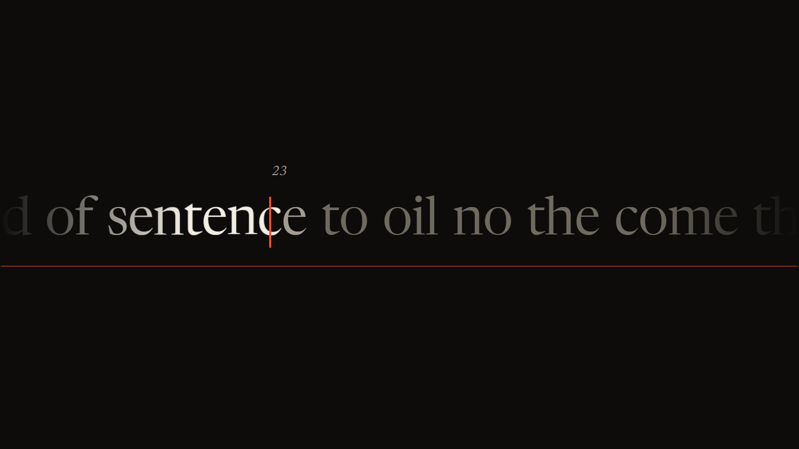
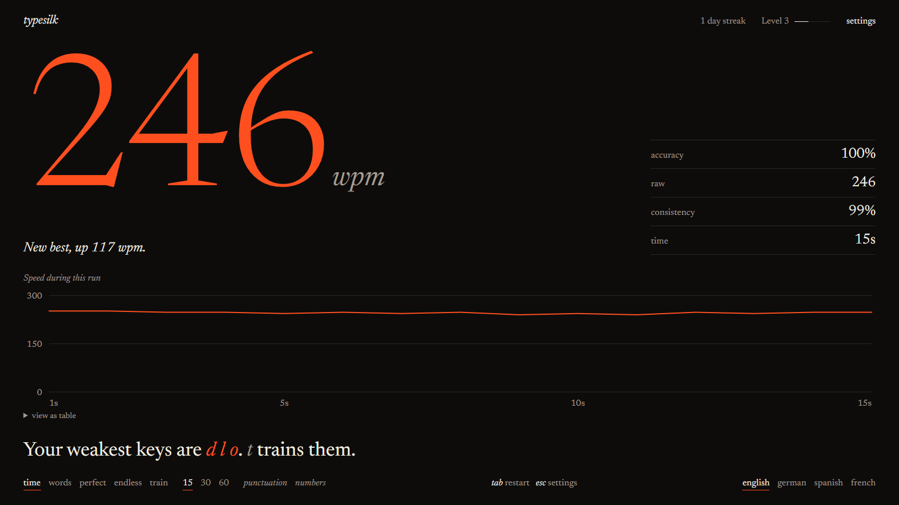
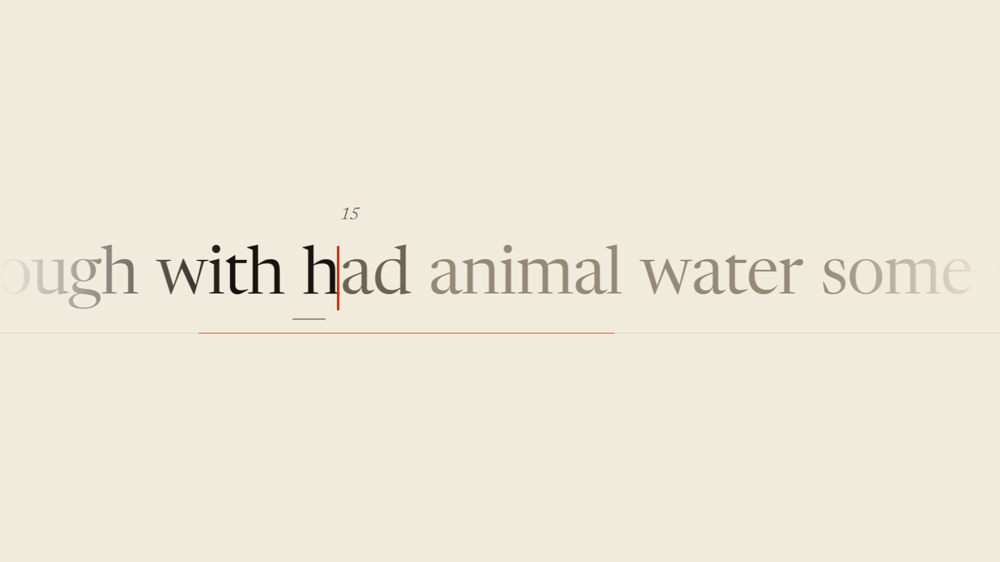
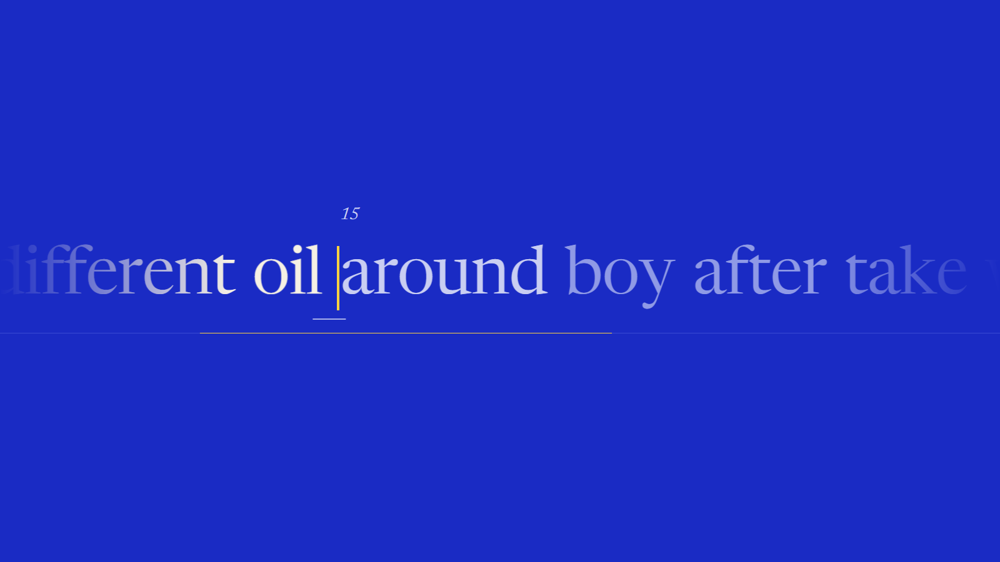
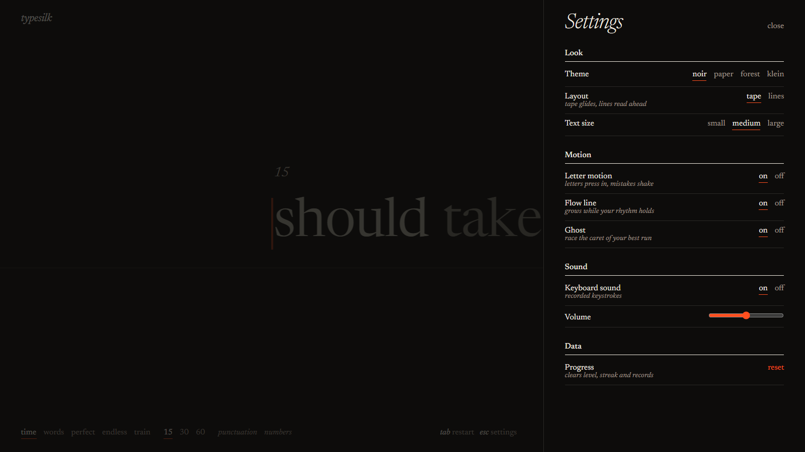

# typesilk

*A typing test that glides.*

The caret stands still and the words travel beneath it, carried by a spring that keeps its momentum between keystrokes. There are no boxes, no glow, just type at the size of a headline and one colour for what matters.

## Why it feels different

Most typing tests start a short animation for every key. Type fast and each one is replaced before it finishes, so the motion keeps restarting from zero.

typesilk retargets one continuous spring instead, so speed carries over from key to key. The faster you type, the smoother it runs.

- **Letters press in.** Each one dips and settles on a spring, and the caret flinches with every press.
- **Mistakes have weight.** Wrong letters shake and turn the signal colour without breaking your rhythm.
- **Real sound.** 30 recorded keystrokes, placed in stereo by where the key sits on the board.
- **Flow line.** A thin rule under the text grows while your rhythm holds, and shrinks when you slip.

## Modes

| Mode | What it does |
| --- | --- |
| **time** | 15, 30 or 60 seconds |
| **words** | 25, 50 or 100 words |
| **perfect** | One mistake ends the run |
| **endless** | Runs until you press `esc` |
| **train** | Words built around your weakest keys |

Available in English, German, Spanish and French, with optional punctuation and numbers.

## Get better, then come back



- **Your ghost.** A second marker replays your best run in the same setup, so you always race someone your own speed.
- **Weak keys.** Every keystroke feeds per-letter error and speed stats. Results name your worst letters, and `t` starts a run built around them.
- **Progress.** A chart of your past runs and your trend over the last five.
- **Level and streak.** XP for clean typing and a count of days in a row.

Everything is stored in your browser. There is no account and no server.

## Make it yours

<table>
  <tr>
    <td></td>
    <td></td>
  </tr>
</table>

Four themes (noir, paper, forest, klein), a tape or lines layout, three text sizes, and a switch for every effect. `prefers-reduced-motion` is respected.



## Keys

| Key | Action |
| --- | --- |
| `tab` | Restart, or one more run |
| `esc` | Settings, stop a run, or finish in endless |
| `t` | Train your weak keys, from the results |
| `ctrl` + `backspace` | Clear the word |

## Run it

```bash
npm install
npm run dev
```

`npm test` runs the unit tests and `npm run build` makes a production build.

It needs a physical keyboard. Touch devices aren't supported yet.

## Under the hood

TypeScript and Vite with no UI framework, so nothing sits between a key and the screen. Letter positions are measured once when a word is created, and every frame after that only moves things with transforms.

Measured in headless Chrome at 1600×900 with 200 keys at one key per 60 ms, a keypress costs 1.6 layout passes, 0.4 ms of layout and 3.0 ms of style recalculation, and no frame was dropped.

## Credits

Typeface: [Newsreader](https://github.com/productiontype/Newsreader), SIL Open Font License. Keystrokes: [Keyboard soundpack 1](https://opengameart.org/content/keyboard-soundpack-1-typing-and-single-keystrokes) by Unicae Games, CC0.

## License

MIT, see [LICENSE](LICENSE).
