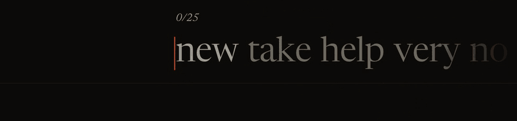
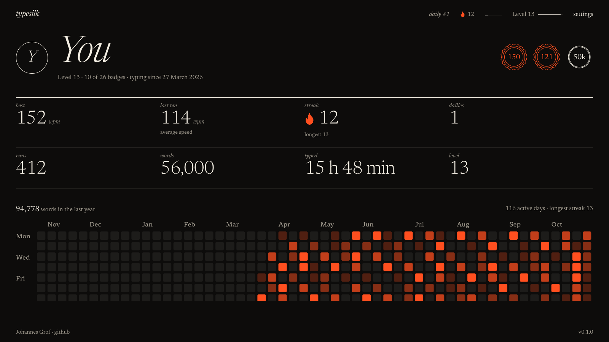
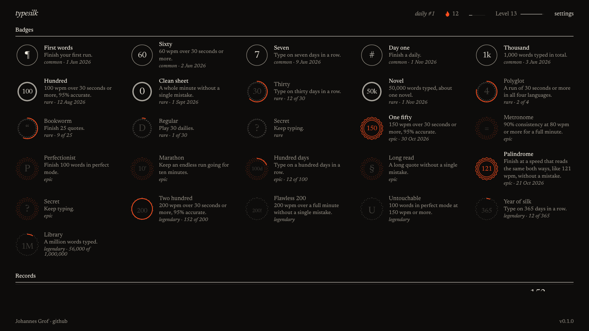
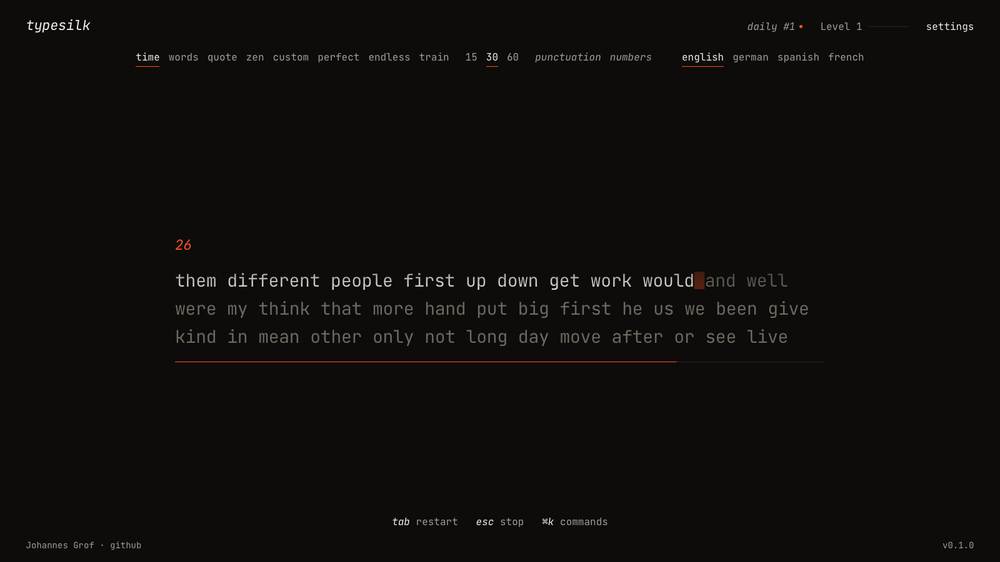
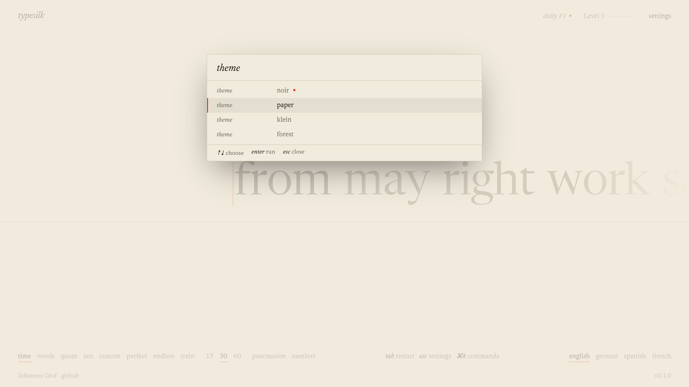

<div align="center">

# typesilk

A typing test for the browser where the words glide under a still caret on a spring, with recorded keystrokes and a coach for your weak keys.

[](https://typesilk.com)
[](https://github.com/jx-grxf/typesilk/releases)
[](LICENSE)

[Open typesilk](https://typesilk.com) · [Design system](DESIGN.md)



</div>

Most typing tests start a short animation for every key, so when you type fast each one is cut off and the motion keeps restarting. typesilk moves the text with one continuous spring that keeps its speed between keystrokes. The faster you type, the smoother it runs.

## What it does

**Typing**
- Letters press in on a spring, wrong ones shake and turn the accent colour without breaking your rhythm.
- Three layouts: *tape* (one line at headline size), *lines* (a page), *classic* (three lines with the setup above).
- Serif or mono type; the caret as a line, block or underline that glides snappy, smooth or not at all.
- Four sound packs cut from real recordings (crisp, laptop, office, typewriter), placed in stereo by where the key sits.

**Modes**

| Mode | What it does |
| --- | --- |
| **time** | 15, 30 or 60 seconds |
| **words** | 25, 50 or 100 words |
| **quote** | 64 passages from public-domain books and poems, short, medium or long |
| **zen** | No text at all; type anything, `shift` + `enter` ends it |
| **custom** | Paste your own text, optionally shuffled |
| **perfect** | One mistake ends the run |
| **endless** | Runs until you press `esc` |
| **train** | Words built around your weakest keys |
| **daily** | The same 40 words for everyone today; your first try is the one that counts |

English, German, Spanish and French, with optional punctuation and numbers. Word lists go from the 200 most common words up to 20,000 in English, 10,000 in German and 1,000 in Spanish and French.

**Getting better**
- Every result can play the run back key by key at its recorded pace, at 1×, 2× or 4×.
- Your best run in each setup comes back as a ghost caret to race.
- Every keystroke feeds per-letter error and speed stats. Results name your weakest keys, shade them on a keyboard in your language's layout, and `t` starts a run built around them. Slow letter pairs like "th" or "ie" are tracked too and mixed into training.
- A streak with a flame that lights once you've typed today, and a words-per-day goal next to it. One missed day a week is frozen over and doesn't break the streak.


**Your profile** at `/me`: level, best and average speed, streak, a year of activity shaded by words typed per day, a speed chart, records per setup and 36 badges in four rarities, thirteen of them secret.





**Sharing**: `c` copies and `s` saves a 1200 × 630 image of your result, drawn in your theme in the browser.

Everything is stored in your browser and typing never needs an account. typesilk installs as an app and keeps working offline once it has loaded. Signing in with GitHub or Google is optional. It puts your daily on the [leaderboard](https://typesilk.com/daily), where the server replays each run's keystrokes before ranking it, and syncs your profile across devices: each browser uploads its own runs and the profile shows the sum.

## Make it yours

<table>
  <tr>
    <td></td>
    <td></td>
  </tr>
  <tr>
    <td></td>
    <td></td>
  </tr>
</table>

Four themes from the start (noir, paper, forest, klein) and five more that open up at level 5, 10, 15, 20 and 30 (ash, plum, sepia, void, rosso), three text sizes and a switch for every effect. `prefers-reduced-motion` is respected. The command palette reaches every setting without the mouse and previews themes while you move over them.


## Keys

| Key | Action |
| --- | --- |
| `tab` | Restart, or one more run |
| `esc` | Settings, stop a run, or finish in endless and zen |
| `⌘` / `ctrl` + `k` | Command palette |
| `t` | Train your weak keys, from the results |
| `c` / `s` | Copy or save the result image |
| `r` | Play or pause the replay of the run, from the results |
| `ctrl` + `backspace` | Clear the word |

It needs a physical keyboard. Phones and tablets show a note until one is connected.

## Run it

```bash
npm install
npm run dev
```

`npm test` runs the unit tests, `npm run build` makes a production build and `npm run deploy` publishes it as a Cloudflare worker. Accounts and the leaderboard need `npx wrangler d1 migrations apply typesilk --local` and a `.dev.vars` with `TICKET_SECRET` and the OAuth credentials. `node scripts/build-wordlists.mjs` rebuilds the English and German word lists from their sources.

## Under the hood

TypeScript and Vite with no UI framework, so nothing sits between a key and the screen. Letter positions are measured once when a word is created, and every frame after that only moves things with transforms. The look is defined in [`src/tokens.css`](src/tokens.css) and documented in [DESIGN.md](DESIGN.md).

Measured on v0.1.0 in headless Chrome at 1600×900, 200 keys at one key per 60 ms:

| Per keypress | typesilk | Monkeytype |
| --- | --- | --- |
| Layout passes | 1.6 | 11.7 |
| Layout time | 0.4 ms | 1.8 ms |
| Style recalculation time | 3.0 ms | 1.6 ms |

Neither dropped a frame in this test, so this shows where the work goes rather than a visible speed difference. What you feel is the motion design.

## Credits

- Typefaces: [Newsreader](https://github.com/productiontype/Newsreader) and [JetBrains Mono](https://github.com/JetBrains/JetBrainsMono), SIL Open Font License.
- Keystrokes: [Keyboard soundpack 1](https://opengameart.org/content/keyboard-soundpack-1-typing-and-single-keystrokes) by Unicae Games and recordings by Joseph Sardin from [BigSoundBank](https://bigsoundbank.com), all CC0.
- Word lists: [FrequencyWords](https://github.com/hermitdave/FrequencyWords) by Hermit Dave and Wiktionary frequency lists from the Leipzig Corpora Collection, adapted under CC BY-SA 4.0 (see `public/words/LICENSE.txt`).
- Quotes: public-domain works, credited on the results page.
- Name filter: [obscenity](https://github.com/jo3-l/obscenity), MIT, and the [LDNOOBW lists](https://github.com/LDNOOBW/List-of-Dirty-Naughty-Obscene-and-Otherwise-Bad-Words) for German, Spanish and French, CC BY 4.0.

## License

MIT, see [LICENSE](LICENSE). The word lists in `public/words` are CC BY-SA 4.0.
